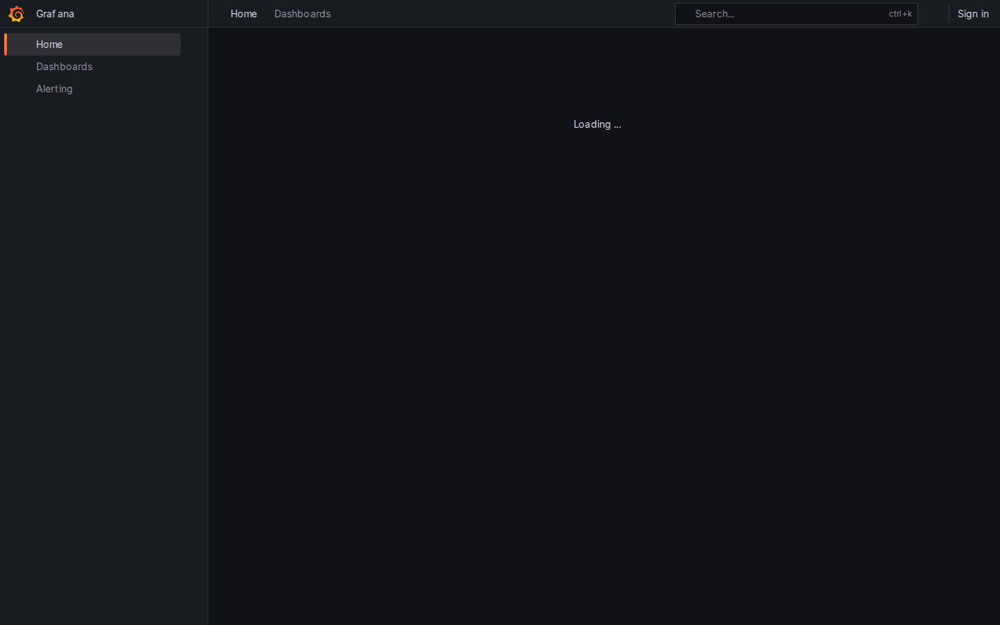

# Informe: despliegue de Grafana con Deployment y ReplicaSet

**Repositorio público:** https://github.com/ericmullo/ProcesosPOD

## 1. Objetivo

Desplegar una plataforma distinta de la utilizada en clase, aplicar los conceptos de Deployment y ReplicaSet, y mostrar cómo se expone el servicio. La plataforma elegida es **Grafana**, una interfaz para visualizar métricas, registros y otros datos operativos mediante paneles.

## 2. Componentes configurados

| Recurso | Archivo | Función |
| --- | --- | --- |
| Namespace `grafana-demo` | `k8s/namespace.yaml` | Aísla los recursos del ejercicio. |
| Deployment `grafana` | `k8s/deployment.yaml` | Declara dos réplicas, imagen, recursos y comprobaciones de salud. |
| ReplicaSet | Creado por Kubernetes | Mantiene en ejecución los dos Pods deseados. Su nombre incluye un hash y varía por despliegue. |
| Service `grafana` | `k8s/service.yaml` | Reparte tráfico entre los Pods y expone el puerto 30030 del nodo. |

El Deployment usa `grafana/grafana:12.1.0`, dos réplicas y estrategia `RollingUpdate`. Las probes HTTP consultan `/api/health`. El acceso anónimo tiene rol `Viewer` para que la interfaz se pueda mostrar sin publicar una contraseña.

## 3. Procedimiento de despliegue

```powershell
kubectl apply -f k8s/namespace.yaml
kubectl apply -f k8s/deployment.yaml
kubectl apply -f k8s/service.yaml
kubectl -n grafana-demo rollout status deployment/grafana --timeout=300s
kubectl -n grafana-demo get deployment,replicaset,pods,service -o wide
```

Para acceder a la plataforma, abrir `http://localhost:30030` en Docker Desktop con Kubernetes. Como alternativa compatible con otros clústeres:

```powershell
kubectl -n grafana-demo port-forward service/grafana 3000:3000
```

Abrir `http://localhost:3000`. La ruta `/api/health` debe responder con estado HTTP 200.

## 4. Aplicación de los conceptos

Un **Pod** ejecuta el contenedor de Grafana. El **ReplicaSet** procura que existan dos Pods que cumplan el selector `app: grafana`. El **Deployment** administra el ReplicaSet y permite cambios declarativos, escalado y actualizaciones graduales. No se define un ReplicaSet manual porque el Deployment lo crea y controla automáticamente.

El **Service** proporciona un punto de acceso estable aunque se reemplace un Pod. `NodePort` expone la aplicación mediante el puerto 30030; `port-forward` permite exponerla temporalmente en el equipo local.

Para demostrar el escalado de 2 a 3 réplicas y volver al estado original:

```powershell
kubectl -n grafana-demo scale deployment/grafana --replicas=3
kubectl -n grafana-demo rollout status deployment/grafana --timeout=300s
kubectl -n grafana-demo get deployment,replicaset,pods
kubectl -n grafana-demo scale deployment/grafana --replicas=2
```

## 5. Usos de Grafana

- Visualizar métricas de servidores, aplicaciones y bases de datos en paneles.
- Consultar y correlacionar datos de observabilidad mediante fuentes conectadas.
- Monitorear disponibilidad, latencia y consumo de recursos.
- Construir alertas operativas cuando se conecte una fuente de datos adecuada.

Este ejercicio muestra la interfaz de Grafana. Para visualizar métricas reales hace falta configurar una fuente de datos, por ejemplo Prometheus; no se incluye en este despliegue.

## 6. Evidencias de ejecución

**Ejecución verificada:** el [flujo de GitHub Actions](https://github.com/ericmullo/ProcesosPOD/actions) creó un clúster temporal con kind, desplegó Grafana, comprobó dos réplicas listas, obtuvo una respuesta válida de `/api/health`, abrió la interfaz y escaló a tres réplicas. Los archivos de evidencia se guardaron en el repositorio. El clúster de CI es temporal; la dirección `localhost` solo es accesible mientras se ejecuta en el equipo o en el runner.

| Comprobación | Resultado observado | Evidencia |
| --- | --- | --- |
| Deployment y ReplicaSet | `2/2` Pods listos; ReplicaSet `DESIRED=2`, `READY=2` | [recursos.txt](evidencias/recursos.txt) |
| Exposición de Grafana | Service `NodePort` `3000:30030/TCP`; `/api/health` devolvió `database: ok` | [salud-http.json](evidencias/salud-http.json) |
| Escalado | Deployment y ReplicaSet `3/3` | [escalado.txt](evidencias/escalado.txt) |

Tras iniciar Kubernetes, guardar las siguientes capturas en `evidencias/` y enlazarlas aquí:

1. [01-recursos.png](evidencias/01-recursos.png): imagen de la salida real de `kubectl` con `2/2`, ReplicaSet y NodePort.
2. [02-grafana.png](evidencias/02-grafana.png): captura real de la interfaz de Grafana abierta en el navegador del runner.
3. [03-escalado.png](evidencias/03-escalado.png): imagen de la salida real de `kubectl` con tres Pods listos.



Las imágenes 01 y 03 presentan las salidas reales de `kubectl` en un formato legible. Si se requiere una captura literal de una terminal local, los comandos de las secciones 3 y 4 permiten obtenerla en el propio equipo.

El script `scripts/capturar-evidencias.ps1` guarda también la salida de Kubernetes y la comprobación HTTP en archivos de texto. Ejecutarlo desde la raíz del repositorio:

```powershell
./scripts/capturar-evidencias.ps1
```

## 7. Conclusión y límites

La configuración declara dos instancias de Grafana gestionadas por un Deployment y su ReplicaSet, con acceso por Service. En este laboratorio cada réplica tiene almacenamiento SQLite local y efímero, por lo que los cambios hechos desde la interfaz pueden diferir entre Pods o perderse al reiniciarlos. Para producción se necesitarían base de datos y almacenamiento compartidos, autenticación y una exposición de red protegida.

## Fuentes

- [Documentación oficial de Deployment](https://kubernetes.io/docs/concepts/workloads/controllers/deployment/)
- [Documentación oficial de ReplicaSet](https://kubernetes.io/docs/concepts/workloads/controllers/replicaset/)
- [Documentación oficial de Grafana en Docker](https://grafana.com/docs/grafana/latest/setup-grafana/installation/docker/)
